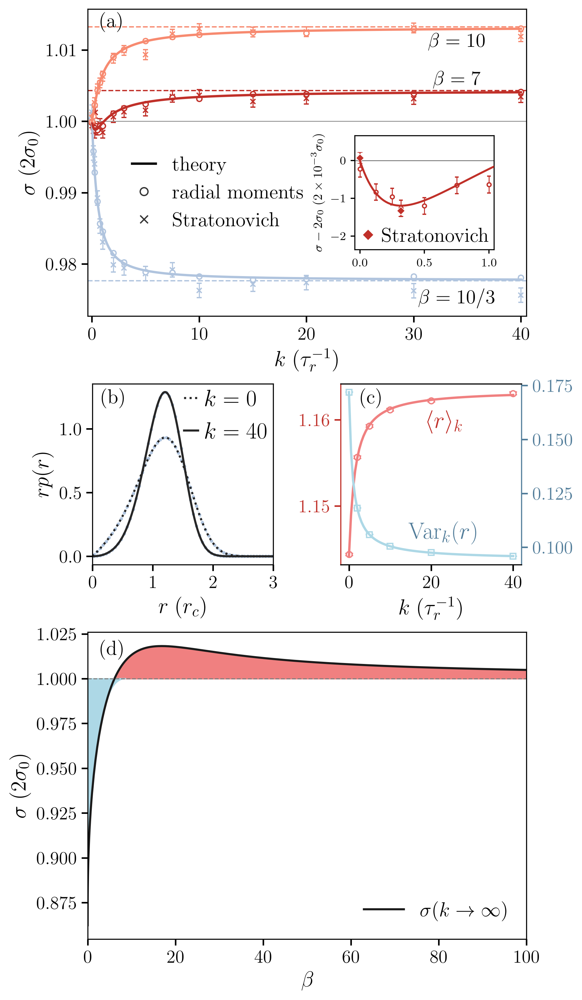
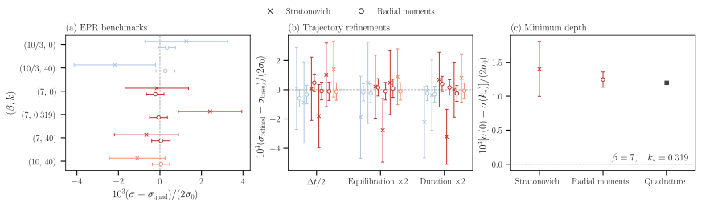

# Figure 2: radial coupling

<p align="center">
  <a href="figure2.png"></a>
</p>

## Data files

| File in `data/` | Contents and use |
| --- | --- |
| [`figure.npz`](data/figure.npz) | Plotted simulation estimates and histograms at $\beta=10/3$ and $k=0,40$. Radial-variance bars are jackknife standard errors. |
| [`theory.npz`](data/theory.npz) | Stationary curves, radial densities, strong-coupling limits and minimum envelope. |
| [`parameters.json`](data/parameters.json) | Simulation and quadrature settings. |
| [`validation.json`](data/validation.json) | Estimator comparisons, simulation refinements and minimum depth and location checks. |
| [`numerics.csv`](data/numerics.csv), [`series.csv`](data/series.csv) | Exact quadrature comparisons and separate checks of the appendix series. |

The [raw validation archive](../../data-bundles/README.md) supplies
`replicas.npz` to replay the simulation checks.

## Recalculate

Run from the repository root. Omit `--theory-dir` to use the saved theory
and quadrature checks. A full `compute` run writes the figure estimates
and validation results.

```bash
python figures/fig02_radial_pair/figure2.py theory --outdir results/fig02_theory
python figures/fig02_radial_pair/figure2.py compute --theory-dir results/fig02_theory --outdir results/fig02_new --threads 4
python figures/fig02_radial_pair/figure2.py plot --outdir results/fig02_new
```

Use `compute --case RUN_ID` (repeatable) to rerun selected simulations.
Pass the run directory to `plot_validation.py --outdir` to draw its checks.

## Validation



Panel (a) compares the Stratonovich and simulated radial-moment estimates of
$\sigma/(2\sigma_0)$ with quadrature. Panel (b) shows refinement changes,
using the case order in (a). Bars are pointwise 95% confidence intervals.

At $\beta=7$, the longer Stratonovich runs shown in validation panel (c)
give a drop from the uncoupled EPR of 0.00140 [0.00100, 0.00181] in normalized units, compared
with 0.00120 by quadrature. The depth is better resolved than the location.
The 95% bootstrap interval for the radial-moment minimizer over the sampled
couplings is 0.207 to 0.638 in units of $\tau_r^{-1}$.

| Check | Values compared | Largest absolute change |
| --- | --- | --- |
| Finite-coupling EPR and radial moments | 96 versus 192 nodes, a 25% larger cutoff and independent adaptive integration. | $2.6\times10^{-15}$ |
| Strong-coupling EPR | Adaptive integration versus 288-node quadrature with a 25% larger cutoff. | $3.3\times10^{-16}$ |
| Minimum envelope | Doubled nodes, a 25% larger cutoff and upper search bound raised from 4,000 to 40,000. | $3.1\times10^{-15}$ in normalized EPR and $3.5\times10^{-10}\tau_r^{-1}$ in finite minimum location. |

[`numerics.csv`](data/numerics.csv) also gives the exact density and
normalization checks. `search_boundary` flags a search ending at its upper bound.

### Series check

Run [`python check_series.py`](check_series.py) from this folder to compare
the appendix EPR series and quadrature at $\beta=7$ near the minimum and at
$k=0.65$. The tested truncations and precisions agree with quadrature to
roundoff, as recorded in [`series.csv`](data/series.csv). The plots use quadrature.
