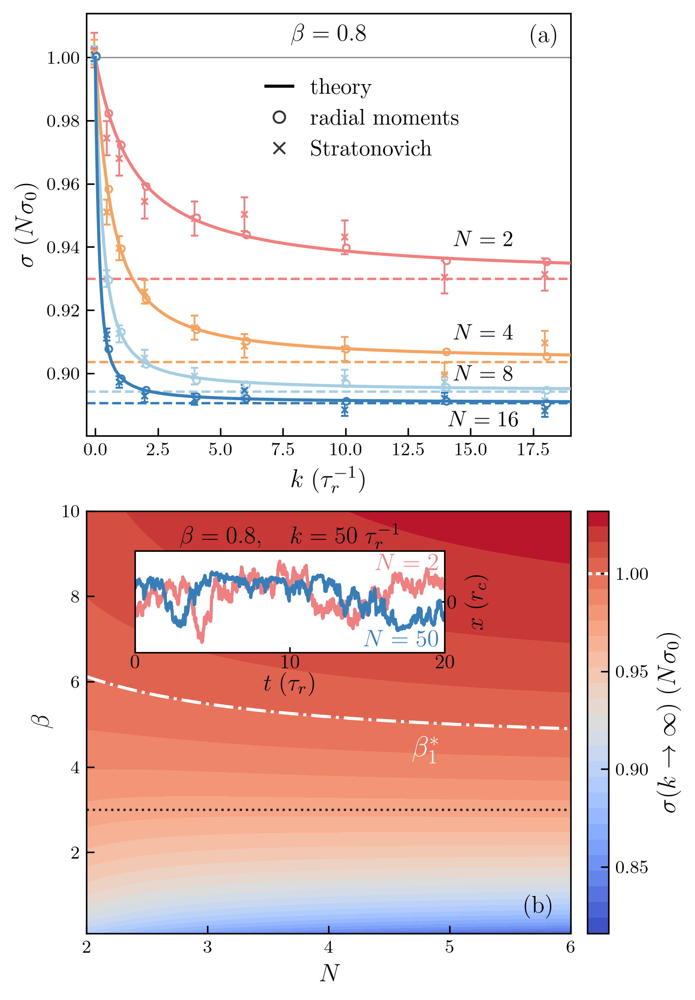
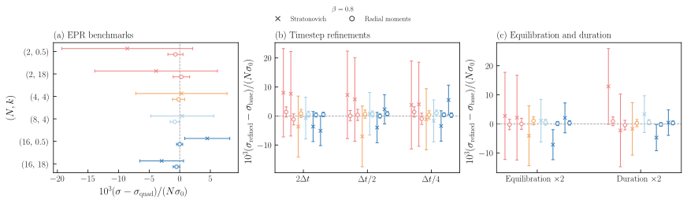

# Figure 3: radial coupling across population sizes

<p align="center">
  <a href="figure3.png"></a>
</p>

## Data files

| File in `data/` | Contents and use |
| --- | --- |
| [`figure.json`](data/figure.json) | Simulation estimates with one-standard-error bars. Panel (a) holds the per-edge coupling $k$ fixed across population sizes. |
| [`theory.npz`](data/theory.npz) | Stationary curves and strong-coupling limits for the dashed levels and contour. |
| [`sample_trajectories.npz`](data/sample_trajectories.npz) | Inset $x(t)$ trajectories for $N=2$ and $N=50$. |
| [`parameters.json`](data/parameters.json) | Simulation and inset settings, including seeds. |
| [`validation.json`](data/validation.json) | Estimator comparisons and simulation refinements with pointwise 95% intervals. |
| [`numerics.csv`](data/numerics.csv) | Exact compared values for the stationary quadrature and strong-coupling checks. |

The [raw validation archive](../../data-bundles/README.md) supplies the
per-system measurements in `replicas.npz` for replaying the simulation checks.

## Recalculate

The stationary quadrature uses the Gaussian integral identity in Methods.
To use the supplied stationary curves, skip `theory` and omit `--theory-dir`.

```bash
python figures/fig03_radial_population/figure3.py theory --outdir results/fig03_theory
python figures/fig03_radial_population/figure3.py compute --threads 4 \
  --theory-dir results/fig03_theory --outdir results/fig03_new
python figures/fig03_radial_population/figure3.py validate --outdir results/fig03_new
python figures/fig03_radial_population/figure3.py plot --outdir results/fig03_new
```

## Validation



Panel (a) compares the midpoint Stratonovich and simulated radial-moment
EPR estimates with stationary quadrature. Panels (b,c) show changes under
simulation refinements in the same case order. EPR is divided by $N\sigma_0$,
$k$ is in $\tau_r^{-1}$ and bars show pointwise 95% confidence intervals.

| Check | Values compared | Largest absolute change in normalized EPR |
| --- | --- | --- |
| Finite coupling | Radial cutoff $7r_c\to8r_c$, scaled auxiliary range from $\pm12$ to $\pm16$, and outer tolerances $10^{-10}\to10^{-11}$ at $\beta=0.8$ for the four plotted sizes and $k=0.001,0.5,19$. | $1.7\times10^{-14}$ |
| Strong-coupling limit | 35 versus 70 decimal digits at $N=2,16$ and $\beta=0.1,10$. | No change at stored precision |

The individual results are in [`numerics.csv`](data/numerics.csv).
