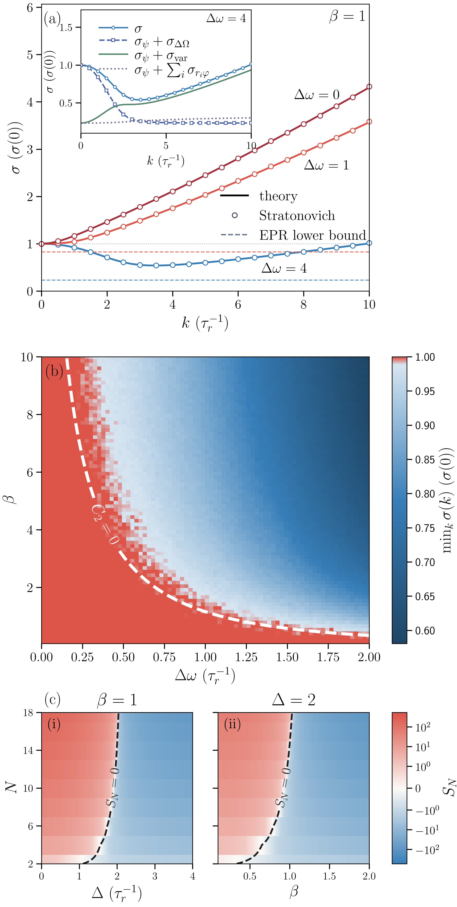
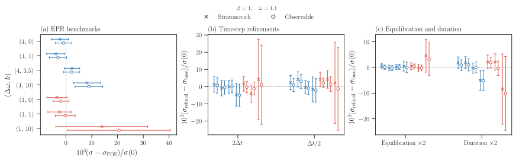

# Figure 4: phase coupling

<p align="center">
  <a href="figure4.png"></a>
</p>

## Data files

| File in `data/` | Contents and use |
| --- | --- |
| [`figure.npz`](data/figure.npz), [`theory.npz`](data/theory.npz) | Simulation and stationary PDE results for panel (a) and its inset. EPR is divided by the uncoupled value at each detuning. Bars show one standard error, with jackknife errors for the inset's mean-rate term. |
| [`minimum_grid.npz`](data/minimum_grid.npz) | Simulation means and standard errors at each grid point. Panel (b) minimizes over 14 sampled couplings and divides by the simulated uncoupled value. |
| [`overlay.npz`](data/overlay.npz), [`bimodal.npz`](data/bimodal.npz) | Independently calculated weak-coupling boundary $C_2=0$ in (b) and population coefficient $S_N$ in (c). |
| [`parameters.json`](data/parameters.json) | Model parameters, run settings and seeds. |
| [`validation.json`](data/validation.json), [`numerics.csv`](data/numerics.csv) | Trajectory benchmarks and refinements, and exact values for the stationary and sampled-minimum comparisons. |

The [raw validation archive](../../data-bundles/README.md) restores the
per-pair measurements and the 80 rows used to assemble the minimum map.

## Recalculate

`compute` reruns the trajectories and uses the supplied stationary curves,
minimum map and weak-coupling results.

```bash
python figures/fig04_phase_coupling/figure4.py compute --threads 4 --outdir results/fig04
python figures/fig04_phase_coupling/figure4.py plot --outdir results/fig04
```

To recalculate the other inputs, run these subcommands with separate
`--outdir` directories, then pass those directories to `compute --inputs`.

| Subcommand | Result |
| --- | --- |
| `theory` | Stationary PDE curves and inset contributions in (a). |
| `heatmap` | The sampled minimum map in (b). Use `--beta-rows` to split the calculation. |
| `overlay` and `weak-response` | The $C_2=0$ boundary in (b) and the $S_N$ slices in (c), respectively. |

For split heatmap runs, use `assemble-heatmap --inputs` with the row
directories. For archived rows, restore the bundle and pass
`--inputs figures/fig04_phase_coupling` instead.

After restoring the archive, `validate` replays the supplied trajectory checks.
For a new run, use `validate --outdir results/fig04 --report results/fig04/data/validation.json`.
Use `numerics --outdir results/fig04_numerics` to replay the numerical
comparisons on the supplied figure inputs.

## Validation



Panel (a) compares the two trajectory estimators with the finest checked
stationary PDE where available. Panels (b,c) show changes under trajectory
refinements, paired by seed. Bars show pointwise 95% confidence intervals.

In manuscript panel (a), the largest Stratonovich discrepancy is 0.86%
relative to the plotted PDE at $\Delta\omega=4$ and $k=10$. The
discrepancy for the same case is 0.81% relative to the refined PDE.

| Check | Values compared | Largest difference |
| --- | --- | --- |
| PDE EPR | 40 versus 80 radial cells at five cases. | 0.0470% of baseline EPR |
| Sampled minimum | Simulation versus PDE minima on the same 14-point coupling grid at two map cells. | $1.8\times10^{-3}$ in $\sigma_{\min}/\sigma(0)$ |
| $C_2=0$ boundary | 160 versus 200 radial cells. | $3.2\times10^{-5}\tau_r^{-1}$ in detuning |
| Population coefficient $S_N$ | 80 versus 120 radial cells at selected points for $N=2,30$. | $6.0\times10^{-2}$ |

[`numerics.csv`](data/numerics.csv) also records the domain, Fourier-mode
and inset integration checks. The CSV stores EPR in simulation units unless
marked `normalized_epr`. For the minimum map, `sampled_k` minimizes
the simulation means and `k` minimizes the stationary PDE values on the
same grid.

- `stratonovich_epr` — Full-drift midpoint Stratonovich estimate.
- `observable_epr` — Phase-coupling EPR expression from the manuscript’s *EPR in terms of observables* paragraph, evaluated on the same trajectories.
- `stationary_pde_epr` — EPR from the stationary PDE, using the refined grid where available.
