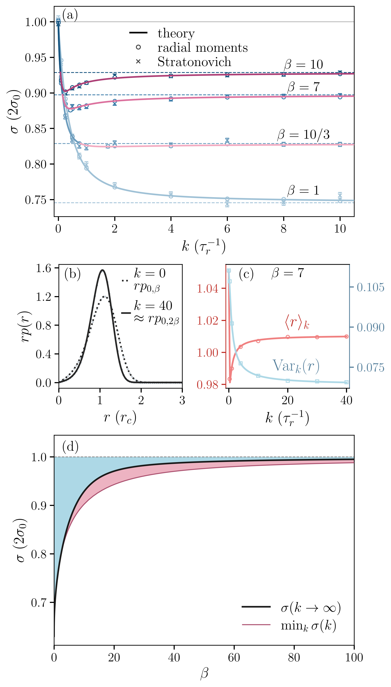
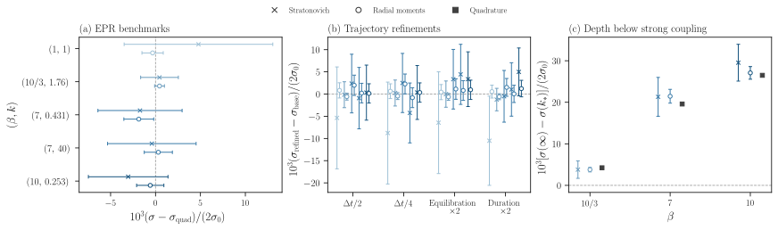

# Figure 5: full Cartesian coupling

<p align="center">
  <a href="figure5.png"></a>
</p>

## Data files

| File in `data/` | Contents and use |
| --- | --- |
| [`figure.npz`](data/figure.npz) | Plotted simulation estimates and histograms at $\beta=7$ and $k=0,40$. Bars and bands show one standard error, with jackknife errors for radial variance. |
| [`theory.npz`](data/theory.npz) | Stationary curves, radial densities, strong-coupling limits and minimum envelope. |
| [`parameters.json`](data/parameters.json) | Simulation and quadrature settings. |
| [`replicas_moments.npz`](data/replicas_moments.npz) | Per-pair measurements at $\beta=7$, $k=20,30$ for panel (c). |
| [`validation.json`](data/validation.json) | Estimator comparisons, simulation refinements and minimum depth and location checks. |
| [`numerics.csv`](data/numerics.csv), [`series.csv`](data/series.csv) | Exact quadrature comparisons and separate checks of the appendix series. |

The [raw validation archive](../../data-bundles/README.md) supplies
`replicas.npz` to replay the simulation checks.

## Recalculate

Run from the repository root. Omit `--theory-dir` to use the saved theory and
quadrature checks. Run `validate` after the full simulation to build the figure
estimates and validation results.

```bash
python figures/fig05_cartesian_pair/figure5.py theory --outdir results/fig05_theory
python figures/fig05_cartesian_pair/figure5.py compute --theory-dir results/fig05_theory --outdir results/fig05_new --threads 4
python figures/fig05_cartesian_pair/figure5.py validate --outdir results/fig05_new
python figures/fig05_cartesian_pair/figure5.py plot --outdir results/fig05_new
```

Use `compute --case RUN_ID` (repeatable) to rerun selected simulations.
Pass the run directory to `plot_validation.py --outdir` to draw its checks.

## Validation



Panel (a) compares the Stratonovich and simulated radial-moment estimates of
$\sigma/(2\sigma_0)$ with quadrature. Panel (b) shows refinement changes,
using the case order in (a). Bars are pointwise 95% confidence intervals.

Panel (c) measures the drop below the strong-coupling EPR at the quadrature
minimum $k_*$. The smallest Stratonovich depth shown is at $\beta=10/3$,
0.00379 [0.00169, 0.00589] in normalized units. Squares show the quadrature
depths. The simulation-based minimum locations use a bootstrap over the
sampled couplings.

| Check | Values compared | Largest absolute change |
| --- | --- | --- |
| Finite-coupling EPR and radial moments | 128 versus 256 nodes, a separate 25% cutoff extension and independent adaptive integration. | $2.4\times10^{-15}$ |
| Strong-coupling EPR | Adaptive integration versus 384-node quadrature with a 25% larger cutoff. | $4.4\times10^{-16}$ |
| Minimum envelope | Doubled nodes and a separate increase of the upper search bound from 400 to 4,000. | $1.9\times10^{-15}$ in normalized EPR and $2.2\times10^{-13}\tau_r^{-1}$ in finite minimum location. |

[`numerics.csv`](data/numerics.csv) also gives the exact density and
normalization checks. `search_boundary` flags a search ending at its upper bound.

### Series check

Run [`python check_series.py`](check_series.py) from this folder to compare
the appendix EPR series and quadrature near the minima at $\beta=7$ and
$10/3$. At $\beta=10/3$, agreement to about $6\times10^{-15}$ required 750
terms at 100-digit precision among the settings tested in
[`series.csv`](data/series.csv). The plots use quadrature.
