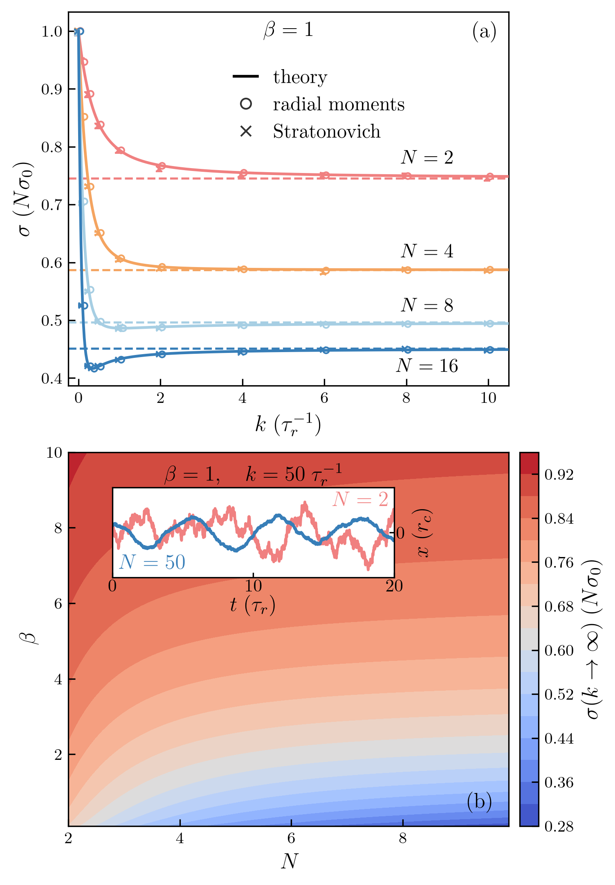
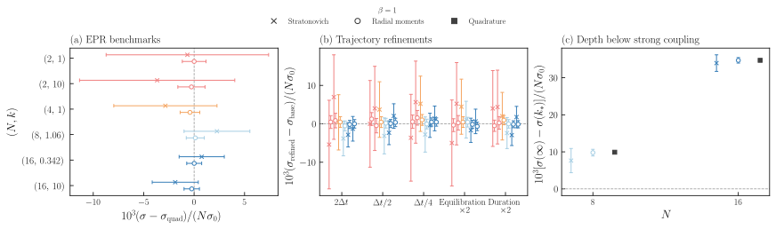

# Figure 6: Cartesian coupling across population sizes

<p align="center">
  <a href="figure6.png"></a>
</p>

## Data files

| File in `data/` | Contents and use |
| --- | --- |
| [`figure.json`](data/figure.json) | Simulation estimates with one-standard-error bars. Panel (a) holds the per-edge coupling $k$ fixed across population sizes. |
| [`theory.npz`](data/theory.npz) | Stationary curves, strong-coupling limits and quadrature benchmarks at the simulated parameters. |
| [`sample_trajectories.npz`](data/sample_trajectories.npz) | Inset $x(t)$ trajectories for $N=2$ and $N=50$. |
| [`parameters.json`](data/parameters.json) | Simulation and inset settings, including seeds. |
| [`validation.json`](data/validation.json) | Estimator comparisons, simulation refinements and minimum depths with pointwise 95% intervals. |
| [`numerics.csv`](data/numerics.csv) | Exact compared values for the stationary quadrature and strong-coupling checks. |

The [raw validation archive](../../data-bundles/README.md) supplies the
per-system measurements in `replicas.npz` for replaying the simulation checks.

## Recalculate

The stationary quadrature uses the Gaussian integral identity in Methods.
To use the supplied stationary curves, skip `theory` and omit `--theory-dir`.

```bash
python figures/fig06_cartesian_population/figure6.py theory --outdir results/fig06_theory
python figures/fig06_cartesian_population/figure6.py compute --threads 4 \
  --theory-dir results/fig06_theory --outdir results/fig06_new
python figures/fig06_cartesian_population/figure6.py validate --outdir results/fig06_new
python figures/fig06_cartesian_population/figure6.py plot --outdir results/fig06_new
```

## Validation



Panel (a) compares the midpoint Stratonovich and simulated radial-moment
EPR estimates with stationary quadrature. Panel (b) shows changes under
simulation refinements in the same case order. EPR is divided by $N\sigma_0$,
$k$ is in $\tau_r^{-1}$ and bars show pointwise 95% confidence intervals.

Panel (c) compares the depth below the strong-coupling limit at the
stationary minimum $k_*$. Both simulation estimators give positive depths
for $N=8$ and $N=16$. Squares give the quadrature depths.

| Check | Values compared | Largest absolute change in normalized EPR |
| --- | --- | --- |
| Finite coupling | At $\beta=1$, more outer and inner nodes, a larger radial cutoff and a wider auxiliary integration range. The auxiliary refinement extends the outer field and the radial window to test the omitted tails. | $3.4\times10^{-15}$ |
| Independent quadrature | Fixed-node versus nested adaptive integration over the full radial interval at the six cases in validation panel (a). | $2.2\times10^{-15}$ |
| Strong-coupling limit | 35 versus 70 decimal digits at $N=2,16$ and $\beta=0.1,10$. | No change at stored precision |

The individual results are in [`numerics.csv`](data/numerics.csv), including
the combined refinement at $k=0.001\tau_r^{-1}$.
