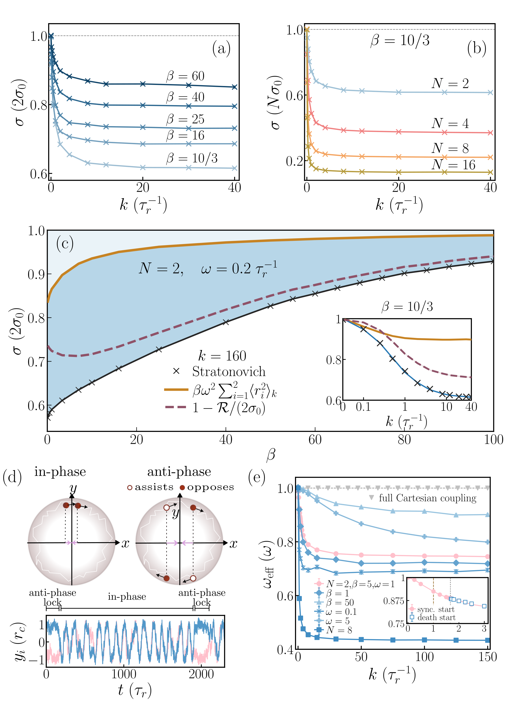
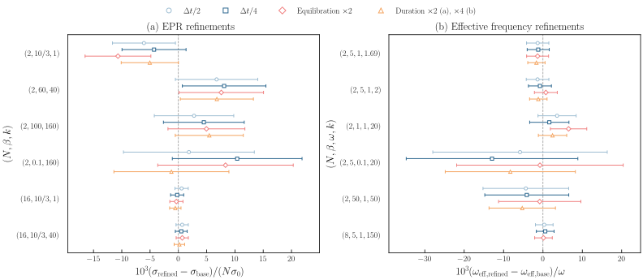

# Figure 7: single-coordinate Cartesian coupling

<p align="center">
  <a href="figure7.png"></a>
</p>

## Data files

| Dataset | Contents and use |
| --- | --- |
| Baseline EPR | EPR versus coupling in (a,b) and the decomposition in the inset of (c), with one-standard-error uncertainties in [`figure.json`](epr/data/figure.json), settings and seeds in [`parameters.json`](epr/data/parameters.json), and estimator, simulation-refinement and finite-coupling comparisons in [`validation.json`](epr/data/validation.json). |
| Longer EPR runs | EPR and its decomposition versus $\beta$ at $k=160$ in (c), with one-standard-error uncertainties in [`figure.json`](epr/long_runs/data/figure.json), settings and seeds in [`parameters.json`](epr/long_runs/data/parameters.json), and estimator and measurement-half comparisons in [`validation.json`](epr/long_runs/data/validation.json). |
| Locking, panel (d) | In the [schematic](frequency/assets/schematic_a.svg), coupling opposes rotation for the red anti-phase pair and assists it for the white pair. The saved envelopes of the illustrative trajectories are in [`locking_trajectory_envelope.npz`](epr/data/locking_trajectory_envelope.npz). |
| Effective frequency, panel (e) | Estimates and one-standard-error bars in [`figure.json`](frequency/data/figure.json), settings and seeds in [`parameters.json`](frequency/data/parameters.json), and numerical checks in [`validation.json`](frequency/data/validation.json). |

The dashed curve in (c) subtracts $\mathcal R/(2\sigma_0)$ from unity.
The inset subtracts it from the normalized uncoupled Stratonovich estimate.

The [raw validation archive](../../data-bundles/README.md) restores
`replicas.npz` for each EPR dataset and the run files in `frequency/data/runs/`.
These hold the per-system measurements used to replay the checks.

## Recalculate

Each command reruns one dataset. Choose a new run directory.

```bash
python figures/fig07_single_coordinate/epr/figure7.py compute --outdir results/fig07_epr
python figures/fig07_single_coordinate/epr/figure7.py compute-plateau --outdir results/fig07_long
python figures/fig07_single_coordinate/frequency/dynamics.py compute --outdir results/fig07_frequency
```

For each completed dataset, use the same script and directory with
`validate --outdir RUN_DIR` to build the plot summaries and checks.
To replay the checks from the archive, copy each restored `data/` directory
into its own run directory, then use the same validation command.

This command assembles the three recalculated datasets into the figure.

```bash
python figures/fig07_single_coordinate/epr/figure7.py plot \
  --outdir results/fig07_epr --plateau-outdir results/fig07_long \
  --dynamics-outdir results/fig07_frequency
```

The validation plot uses the baseline EPR and frequency run directories.
Pass those two paths as `--outdir` and `--dynamics-outdir` to `plot_validation.py`.

## Validation



**(a)** Stratonovich EPR and **(b)** effective frequency changes after the
indicated simulation refinements. Points show refined minus baseline
estimates, multiplied by $10^3$; bars show pointwise 95% confidence intervals.
The row labels identify each case, with $k$ and $\omega$ in $\tau_r^{-1}$.
All EPR cases have $\omega=0.2\tau_r^{-1}$. The effective frequency duration check
covers the first five rows.

The table gives the largest absolute change in each group and its pointwise
95% confidence interval. Error bars in the manuscript figure show one
standard error. EPR is divided by $N\sigma_0$ from Eq. (6), and effective
frequency by $\omega$.

| Check | Values compared; case | Change [95% interval] |
| --- | --- | --- |
| Finite coupling | Baseline pair EPR at $k=160$ minus $k=80$, over all tested $\beta$; largest change at $\beta=0.1$. | $-0.01360\;[-0.02524,-0.00196]$ |
| EPR estimators | Stratonovich minus observable estimate on the same trajectories, over the longer $k=160$ runs; $\beta=0.1$. | $-0.00183\;[-0.00542,+0.00176]$ |
| Initial state | Effective frequency after fixed-point versus synchronized initialization; largest change across the recorded initial-state comparisons at $(N,\beta,\omega,k)=(2,5,1,2.5)$. | $+0.00361\;[+0.00080,+0.00642]$ |

Exact comparisons, measurement-half checks and phase diagnostics are in the
[baseline EPR](epr/data/validation.json), [long-run EPR](epr/long_runs/data/validation.json)
and [effective frequency](frequency/data/validation.json) files.

The EPR and frequency runs use Eq. (48). The saved quantities are:

- `stratonovich_epr` — Full-drift midpoint Stratonovich estimate, shown by crosses in (a–c).
- `observable_epr` — Time average of $`\beta\,\boldsymbol{f}_{\mathrm{rot}}\cdot\mathbf{A}`$ divided by $N\sigma_0$. The dot product uses the intrinsic rotational drift and the full drift.
- `radial_reference` — $\beta\omega^2\sum_i\langle r_i^2\rangle_k/(N\sigma_0)$.
- `correction` — $\mathcal R/(N\sigma_0)$, estimated as `radial_reference` minus `observable_epr` on each trajectory after equilibration. The standard error is computed across these per-system differences.
- `frequency` — Effective frequency estimated from clockwise phase winding per unit time, averaged over oscillators and divided by $\omega$.
- `*_change`, `*_late_minus_early` — Refined minus baseline, or last minus first measurement half. `*_ci95_half_width` gives the pointwise 95% interval half-width.
