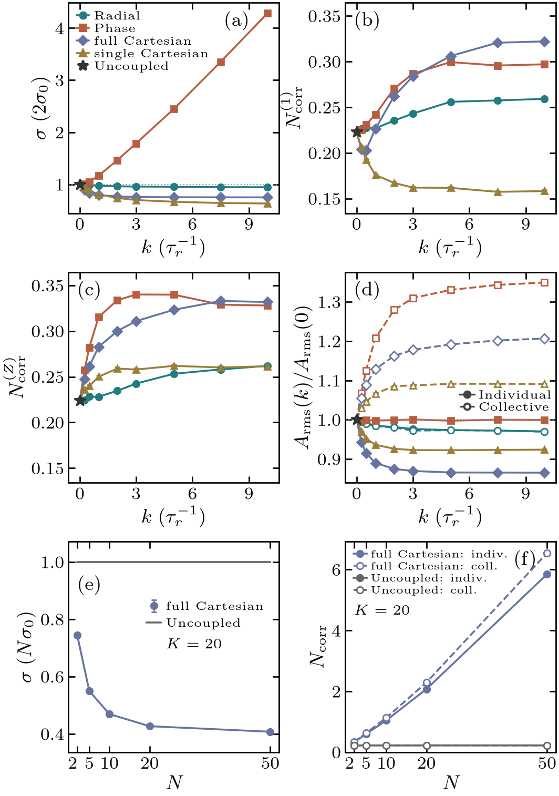
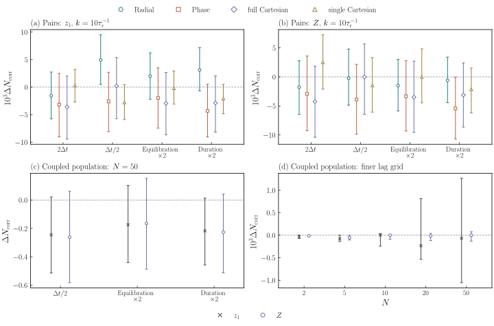

# Figure 8: EPR and oscillatory coherence

<p align="center">
  <a href="figure8.png"></a>
</p>

## Data files

| File | Contents and use |
| --- | --- |
| [`figure.csv`](data/figure.csv) | Plotted estimates with one standard error from bootstrapping whole systems. EPR and RMS amplitude ratios include uncertainty in the measured uncoupled references. |
| [`settings.json`](data/settings.json), [`cases.csv`](data/cases.csv) | Model and run settings, including timesteps, measurement durations, lag grids, replica counts and seeds. |
| [`endpoint_counts.csv`](validation/endpoint_counts.csv), [`endpoint_bootstrap.npz`](validation/endpoint_bootstrap.npz), [`ratio_bootstrap.npz`](validation/ratio_bootstrap.npz) | Coherence crossing times, phases and cycle counts, with bootstrap draws for the counts and plotted ratios. |
| [`endpoint_contrasts.csv`](validation/endpoint_contrasts.csv), [`endpoint_refinements.csv`](validation/endpoint_refinements.csv) | Changes in coherent-cycle counts with coupling and under numerical refinements. |
| [`epr_amplitude_refinements.csv`](validation/epr_amplitude_refinements.csv), [`epr_benchmarks.csv`](validation/epr_benchmarks.csv) | EPR and RMS amplitude refinements, and paired EPR estimator comparisons for full Cartesian populations. |

## Recalculate

These commands rerun the plotted cases and draw the figure from the new estimates.

```bash
python figures/fig08_coherence/figure8.py compute --study both --outdir results/fig08
python figures/fig08_coherence/figure8.py plot --table results/fig08/figure.csv --outdir results/fig08/figures
```

Use `--study pair` or `--study population` to rerun one part. Add
`--variant all` to include the refinement runs, then use `validate --outdir results/fig08`
with the same script to rebuild the comparison tables.

## Validation



Points show refined minus baseline coherent-cycle counts, with pointwise
95% bootstrap intervals. Panels (a,b) show the pair checks at $k=10\tau_r^{-1}$.
Panel (c) shows simulation refinements from the original coupled $N=50$ run,
and (d) halves the maximum lag spacing on the same trajectories.
Panels (a), (b) and (d) scale the differences by $10^3$.

The plotted coupled $N=50$ estimates use $\Delta t=1.25\times10^{-4}\tau_r$
and 1,024 independent systems. Halving the timestep from $2.5\times10^{-4}\tau_r$
with the same system count shifts the individual count by
$-0.056$ cycles $[-0.189,0.081]$ and the collective count by
$-0.055$ cycles $[-0.216,0.105]$. At the finer timestep, coupling increases
collective coherence by $6.32$ cycles $[6.21,6.44]$.

| Check | Case with largest absolute difference | Difference [95% interval] |
| --- | --- | --- |
| Pair EPR refinement | Halved timestep for phase coupling at $k=10\tau_r^{-1}$. | +0.0268 [−0.0099, +0.0639] |
| Population EPR estimators | Stratonovich minus radial-moment estimate on the same trajectories, uncoupled $N=2$. | +0.00253 [−0.00147, +0.00656] |

The EPR differences in the table use the analytical uncoupled normalization
$N\sigma_0$ ($2\sigma_0$ for pairs). The linked CSVs give the unnormalized EPR differences
and the full set of checks, including the saving interval and RMS amplitude.

From this folder, run `python figure8.py validate` to replay the saved
bootstrap intervals and check the reported estimator differences.

- `endpoint_cycles` — $N_\mathrm{corr}$, the magnitude of the unwrapped correlation phase at the first crossing of $1/e$ by the correlation magnitude, divided by $2\pi$.
- `oscillator_1`, `collective` — The individual signal $z_1$ and the population mean $Z$.
