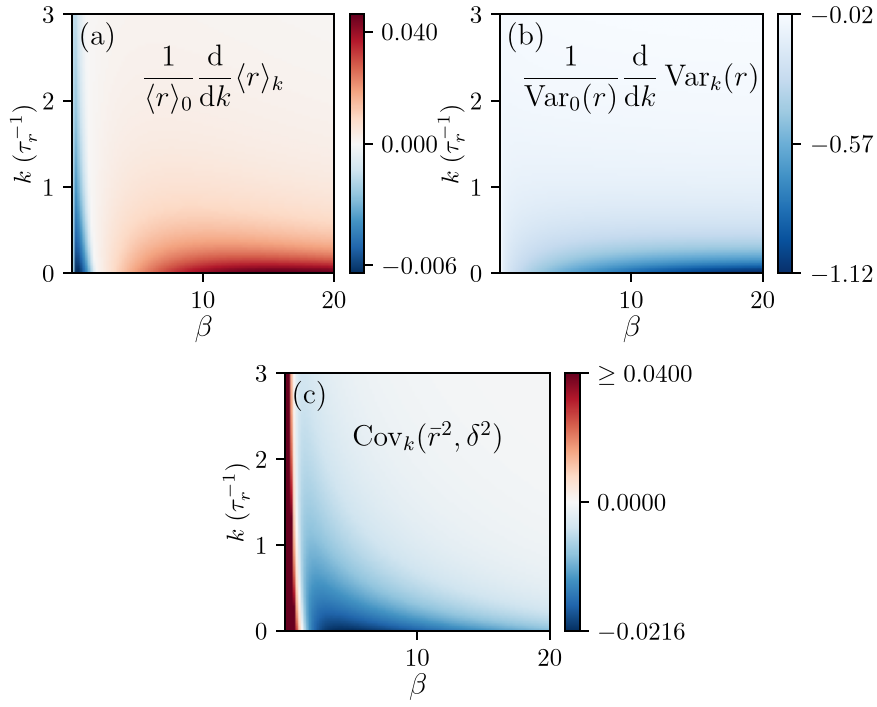
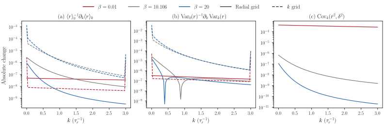

# Figure 10: radial deformation

<p align="center">
  <a href="figure10.png"></a>
</p>

## Data files

| File in `data/` | Contents and use |
| --- | --- |
| [`reference.npz`](data/reference.npz) | The $\beta$ and $k$ grids and plotted arrays. `grads` and `grads_v` are the derivatives of mean radius and radial variance, each divided by the corresponding uncoupled moment. `covs` is the covariance of the squared mean radius and squared radial difference. |
| [`settings.json`](data/settings.json) | Parameter grids and radial point counts. The derivatives use 600 points per radius and the covariance uses 700. |
| [`numerics.csv`](data/numerics.csv) | Exact values for the grid and radial cutoff comparisons, plus an independent quadrature check of the uncoupled covariance. |

## Recalculate

The maps use trapezoidal quadrature of the stationary radial pair density for
$m=n=1$ and finite differences in $k$. The derivatives use one-sided
differences at the grid endpoints.

```bash
python figures/fig10_radial_deformation/figure10.py compute --outdir results/fig10
python figures/fig10_radial_deformation/figure10.py plot --outdir results/fig10
```

Use `validate --outdir results/fig10` with the same script to rebuild `numerics.csv`.

## Validation



Solid lines show the effect of doubling the radial point count. Dashed lines
show the effect of halving the coupling step. Both keep the radial cutoff
fixed. The table gives the largest absolute change across all saved $k$
values in the first, middle and last $\beta$ rows.

| Quantity | Double radial points | Half coupling step |
| --- | --- | --- |
| (a) Normalized mean-radius derivative | $2.52\times10^{-6}$ | $1.40\times10^{-3}$ |
| (b) Normalized variance derivative | $2.53\times10^{-5}$ | $3.77\times10^{-2}$ |
| (c) Radial covariance | $4.21\times10^{-4}$ | — |

The derivatives are most sensitive to the coupling step at $k=0$ and
$\beta=20$, where the difference is one-sided.

The radial cutoff is capped at $12r_c$. At $\beta=0.01$ and $k=0$,
the covariance is 19.65 on the saved domain and 28.59 on the infinite domain.
Both lie above panel (c)'s upper color limit of 0.04, so they give the same
saturated color. The exact compared values are in [`numerics.csv`](data/numerics.csv).
