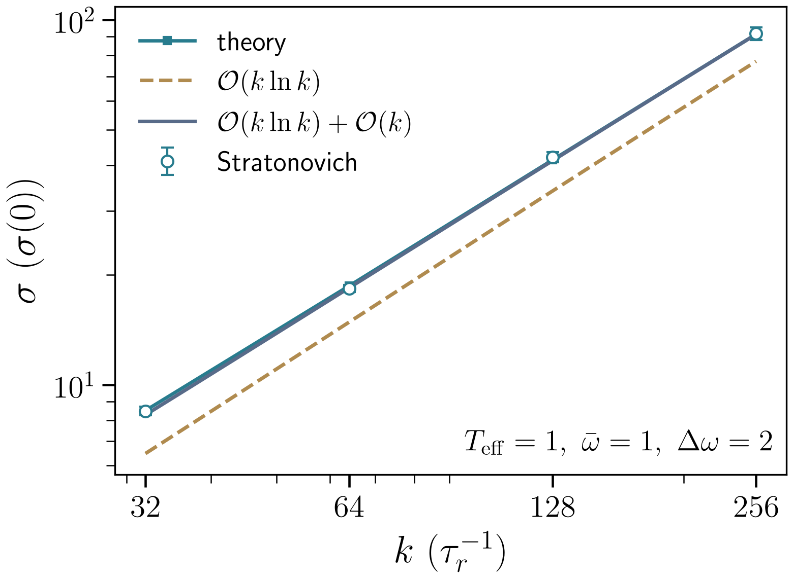
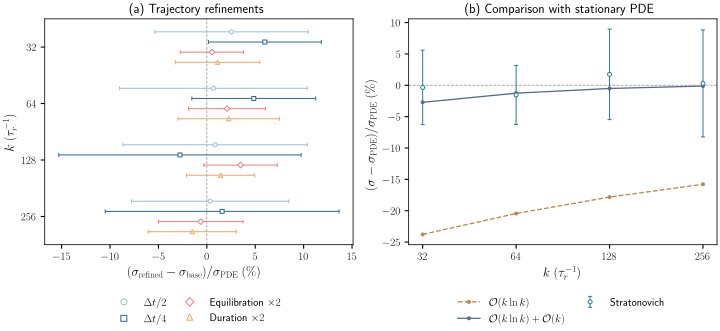

# Figure 11: strong phase coupling

<p align="center">
  <a href="figure11.png"></a>
</p>

## Data files

| File | Contents and use |
| --- | --- |
| [`reference.npz`](data/reference.npz) | Plotted trajectory and stationary PDE results. Stratonovich error bars show one standard error across 12 independent pairs. EPR is divided by its uncoupled value. |
| [`settings.json`](data/settings.json) | Model and run settings, PDE grids and asymptotic coefficients. |
| [`refinements.npz`](validation/refinements.npz), [`report.json`](validation/report.json) | Trajectory and PDE refinement results, with the exact estimator, refinement and asymptotic comparisons. |
| [`coefficients.json`](validation/coefficients.json), [`inner_constant.json`](validation/inner_constant.json) | Independent quadrature of the asymptotic coefficients and convergence of the inner constant $\mathcal C$ used in the linear term. |

## Recalculate

The [phase-coupling solver](../fig04_phase_coupling/numerics.py) calculates
the stationary PDE and the trajectories. Choose a new output directory.

```bash
python figures/fig11_strong_phase_coupling/figure11.py compute --outdir results/fig11
python figures/fig11_strong_phase_coupling/figure11.py plot --outdir results/fig11
```

Add `--baseline-only` to `compute` to run just the plotted cases.
The full calculation also writes the validation report. Use
`validate --report results/fig11_validation.json` with the same script to replay
the saved comparisons.

The independent checks can be recalculated with
[`coefficient_checks.py`](coefficient_checks.py) and [`inner_constant.py`](inner_constant.py).

## Validation



Panel (a) shows changes in Stratonovich EPR after refining the timestep,
equilibration or measurement duration. Panel (b) shows deviations from the
stationary PDE for the Stratonovich estimate and the two approximations.
Both approximations include the constant contribution $\sigma_\psi$.
Differences are percentages of the baseline PDE EPR. Bars show pointwise
95% confidence intervals.

The linear term improves agreement with the PDE at all four plotted couplings.

| $k$ ($\tau_r^{-1}$) | Leading approximation minus PDE | Two-term approximation minus PDE |
| --- | --- | --- |
| 32 | −23.8% | −2.71% |
| 256 | −15.8% | −0.121% |

Increasing the radial grid from 40 to 80 cells changes the PDE EPR by at
most 0.147%, at $k=256$. At this point the two-term approximation is 0.267%
below the refined PDE. The Fourier and domain refinements are recorded in
[`report.json`](validation/report.json).

The trajectory refinement intervals have half-widths of 3.3–12.5% of the
baseline PDE EPR. The largest paired difference between the Stratonovich
and observable estimators is −0.940% [−1.977%, +0.097%] at $k=32$.
