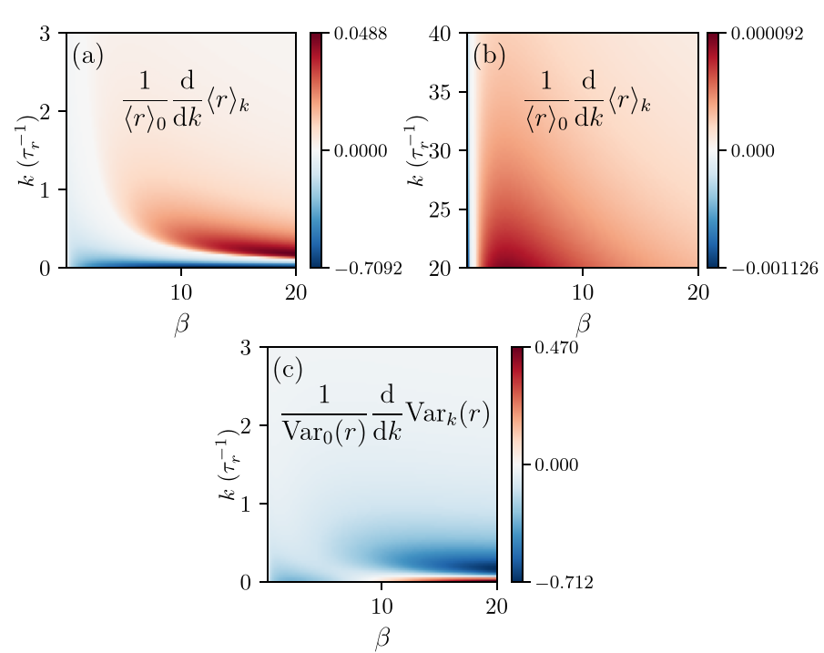
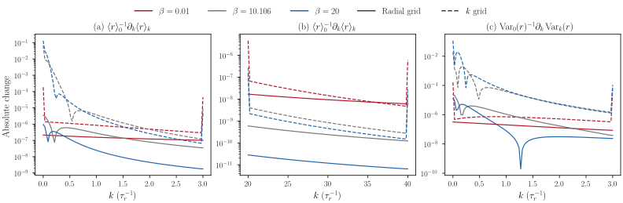

# Figure 12: Cartesian radial deformation

<p align="center">
  <a href="figure12.png"></a>
</p>

## Data files

| File in `data/` | Contents and use |
| --- | --- |
| [`reference.npz`](data/reference.npz) | Plotted grids and derivative maps. The mean-radius derivatives in (a,b) are divided by $\langle r\rangle_0$, and the variance derivative in (c) by $\mathrm{Var}_0(r)$, at the same $\beta$. |
| [`settings.json`](data/settings.json) | Parameter grids and radial resolution. The small-coupling grid covers $k=0$ to $3\tau_r^{-1}$ and the large-coupling grid covers $k=20$ to $40\tau_r^{-1}$. |
| [`numerics.csv`](data/numerics.csv) | Exact compared values for grid refinements, independent checks of the uncoupled normalizations, and the radial cutoff comparison. |

## Recalculate

The maps use trapezoidal quadrature of the phase-integrated Cartesian pair
density for $m=n=1$, with 600 points per radius. The derivatives use finite
differences in $k$, with one-sided differences at the grid endpoints.

```bash
python figures/fig12_cartesian_deformation/figure12.py compute --outdir results/fig12
python figures/fig12_cartesian_deformation/figure12.py plot --outdir results/fig12
```

Use `validate --outdir results/fig12` with the same script to rebuild `numerics.csv`.

## Validation



Solid lines show the effect of doubling the radial point count. Dashed lines
show the effect of halving the coupling step. Both keep the radial cutoff
fixed. The table gives the largest absolute change across all saved $k$
values in the first, middle and last $\beta$ rows.

| Quantity | Double radial points | Half coupling step |
| --- | --- | --- |
| (a) Mean-radius derivative, small $k$ | $3.50\times10^{-6}$ | $1.33\times10^{-1}$ |
| (b) Mean-radius derivative, large $k$ | $1.67\times10^{-8}$ | $4.67\times10^{-6}$ |
| (c) Variance derivative, small $k$ | $2.46\times10^{-5}$ | $1.16\times10^{-1}$ |

The small-coupling maps are most sensitive to the coupling step at $k=0$
and $\beta=20$, where the differences are one-sided. Halving the step
changes the mean-radius derivative from −0.6792 to −0.8126 and the variance
derivative from 0.4695 to 0.5853.

The radial cutoff is capped at $12r_c$. At $\beta=0.01$, integrating to
infinity changes the uncoupled mean radius from 5.21286 to 5.23034 and the
uncoupled variance from 5.39692 to 5.51477. The maps use finite-domain
normalizations. Exact compared values are in [`numerics.csv`](data/numerics.csv).
