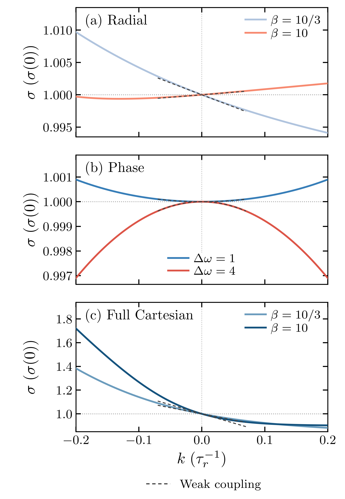
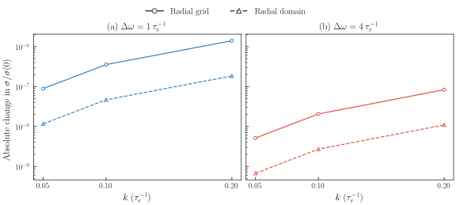

# Figure 13: attractive and repulsive pair coupling

<p align="center">
  <a href="figure13.png"></a>
</p>

## Data files

| File in `data/` | Contents and use |
| --- | --- |
| [`curves.csv`](data/curves.csv) | Plotted stationary EPR divided by the uncoupled pair value at the same frequencies and temperature. |
| [`settings.json`](data/settings.json) | Model parameters, coupling grids, and quadrature and PDE settings. |
| [`weak_coefficients.json`](data/weak_coefficients.json) | Coefficients of the dashed curves. The leading correction is linear in $k$ for radial and full Cartesian coupling and quadratic for phase coupling. |
| [`numerics.csv`](data/numerics.csv) | Exact settings and values compared in the radial quadrature and phase PDE refinements. |

## Recalculate

Choose a new output directory. The solid curves use stationary quadrature
for radial and full Cartesian coupling and the
[phase-coupling solver](../fig04_phase_coupling/numerics.py) for phase coupling.

```bash
python figures/fig13_attractive_repulsive/figure13.py compute --outdir results/fig13
python figures/fig13_attractive_repulsive/figure13.py plot --outdir results/fig13
```

Use `validate --outdir results/fig13` with the same script to recheck selected
curve points and all six weak-coupling coefficients, and rebuild `numerics.csv`.

## Validation



For radial and full Cartesian coupling, reversing $k$ reverses the linear
correction near $k=0$. The quadrature checks include both signs of $k$.
For the phase pair, a relative-phase shift by $\pi$ compensates reversal
of $k$, giving $\sigma(-k)=\sigma(k)$ at finite coupling. The plot mirrors
the positive branch, so the phase PDE checks use positive $k$.

The validation plot shows phase PDE sensitivity to the radial grid and cutoff
at both plotted detunings. Each PDE result is normalized by its uncoupled
value on the same grid.

| Check | Values compared | Largest absolute change in $\sigma/\sigma(0)$ |
| --- | --- | --- |
| Radial and full Cartesian quadrature | 128 versus 192 nodes per radius, plus a separate cutoff extension from $6r_c$ to $7r_c$. | $7.77\times10^{-16}$ |
| Phase radial grid | 64 versus 96 cells per radius at cutoff $5r_c$. | $1.41\times10^{-6}$ |
| Phase radial domain | 96 cells to $5r_c$ versus 115 cells to $6r_c$. | $1.84\times10^{-7}$ |

[`numerics.csv`](data/numerics.csv) also records the Fourier-mode comparison.
